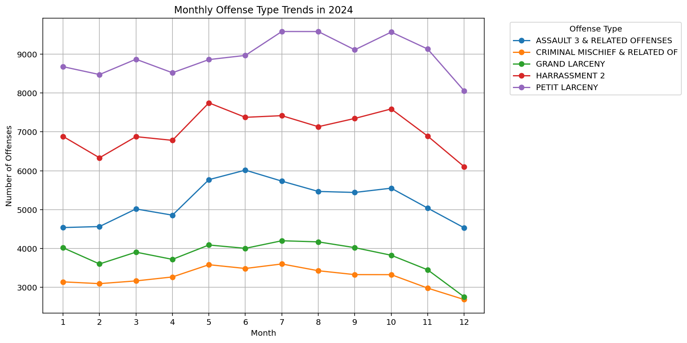

# NYPD Offense Trends: Monthly Time-Series Analysis (2024)

**Python · pandas · Matplotlib** · Group 10 project, Finding 3



## Question
Do the most common offense types in New York City follow a seasonal pattern across the year?

## Data
A cleaned file of NYPD offense records. The analysis uses three fields: `OFNS_DESC` (offense type), `OCC_MONTH` and `OCC_YEAR` (when the offense occurred), filtered to **2024**.
**Source:** raw records come from the NYPD's public complaint data on NYC Open Data: [NYPD Complaint Data Historic](https://data.cityofnewyork.us/Public-Safety/NYPD-Complaint-Data-Historic/qgea-i56i) (`OFNS_DESC` is that dataset's offense field; month and year were derived from the complaint date during cleaning).

The cleaned CSV is about 128 MB, over GitHub's file-size limit, so it isn't stored in this repo. The script expects it as `NYPD_Cleaned 1(in).csv` in the working directory.

## Approach
1. Load the cleaned records and coerce month and year to numbers.
2. Keep 2024 only and find the **top 5 offense types** by count.
3. Group by month and offense type, pivot into a month × offense time-series table.
4. Plot one line per offense type and find each type's **peak month and peak count**.

Script: [`scripts/time_series_by_offense_type.py`](scripts/time_series_by_offense_type.py) · Write-up: [`reports/Group10_Finding_3_Time_Series_Analysis.docx`](reports/Group10_Finding_3_Time_Series_Analysis.docx)

## Results
| Offense type | Peak month | Peak count |
|---|---|---|
| Petit larceny | July | 9,580 |
| Harassment 2 | May | 7,745 |
| Assault 3 & related offenses | June | 6,015 |
| Grand larceny | July | 4,199 |
| Criminal mischief & related offenses | July | 3,602 |

**Finding:** most of the top offense types peak in late spring or summer. Petit larceny was the highest category every month and peaked in July; harassment peaked earlier, in May; assault peaked in June; criminal mischief and grand larceny also peaked in July. Several major offenses then declined noticeably by December.

**Limitation:** this uses one year of data, so it shows a pattern in 2024 but can't prove a long-term seasonal cycle.

## How to run
```bash
pip install pandas matplotlib
python scripts/time_series_by_offense_type.py   # with the cleaned CSV in the working directory
```

## Skills demonstrated
Data cleaning · grouping and pivoting with pandas · time-series trend analysis · data visualization · writing a finding with its limitation

---
**Jada Malone** · Data Analyst · M.S. Data Science, Texas Tech University · [GitHub profile](https://github.com/jada-malone) · [LinkedIn](https://www.linkedin.com/in/jada-malone-509170280)
